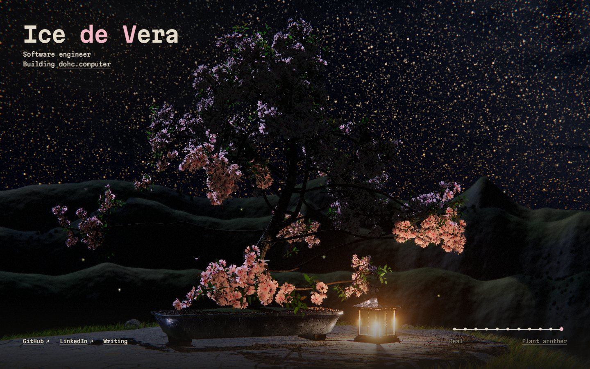

# devfolio-v3

The source of [icedevera.com](https://icedevera.com), my personal site.



The home page grows a bonsai over 40 seconds. It starts as ASCII characters and turns into pixel art, then a flat painting, then a three.js scene you can drag to turn. It ends as a realistic render with soft shadows, ambient occlusion and depth of field. The dots in the corner jump between stages, and "Plant another" grows a new tree from a new seed.

The sky follows the visitor's clock. The sun rises at six and sets at six. At night there's the moon in its current phase, the Milky Way, fireflies, and a lit candle lantern by the pot.

## Stack

- [Astro](https://astro.build) 7, built as static files.
- Canvas 2D for the early stages and [three.js](https://threejs.org) for the 3D ones. three.js loads after the page, while the early stages play.
- A web worker paints the tree and sky ahead of time. The 3D stages build a few milliseconds at a time between frames, so the page never stalls while they get ready.
- [Vercel Web Analytics](https://vercel.com/docs/analytics), included only in builds Vercel makes.

## Develop

You need Node 22.23.4 or later and pnpm.

```sh
pnpm install
pnpm dev       # http://localhost:4321
pnpm check     # type-check
pnpm build     # the static site, in dist/
pnpm preview   # serve dist/
```

In development, three URL parameters help when working on one stage. `?t=30` holds the timeline at 30 seconds, `?hour=21` sets the sky to 9 pm, and `?seed=12345` grows the same tree every time.

## Where things are

- `src/scene/` is the home page's scene. `index.ts` runs the timeline and draws the 2D stages, `depth.ts` is the 3D stage, `real/` is the realistic one, and `paint.worker.ts` paints pictures off the main thread.
- `src/scripts/bonsai.ts` grows the tree and lays it out around the page's text.
- `src/content/articles/` holds the writing, in Markdown. The pages are in `src/pages/`, with an RSS feed at `/feed.xml`.

## License

Copyright (C) 2026 Ice de Vera.

The code is licensed under the [GNU General Public License, version 3 only](LICENSE). The tree's growth is a port of [cbonsai](https://gitlab.com/jallbrit/cbonsai), copyright John Allbritten, which is GPL-3.0 as well. The licenses of what else the site serves, three.js and the Martian Mono font, are in [`public/licenses.txt`](public/licenses.txt).

The license doesn't cover the writing in `src/content/articles/`, its images, or the screenshot in `assets/`. All rights to those are reserved.
